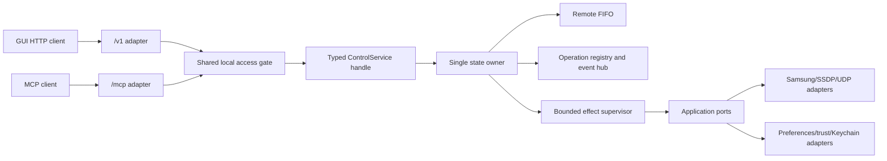

# Phase 2 Control API Server: internal architecture

Status: Proposed design for P2-M6 through P2-M11; not a description of shipped
code. The [target architecture](target-architecture.md) owns product and wire
contracts, and [lifecycle/security research](server-lifecycle-security.md)
owns platform hypotheses that require signed-bundle proof. This document
defines the server's internal ownership and execution model. It does not
choose an HTTP crate or claim that macOS permission and Keychain gates pass.

## Design decisions

1. One per-user server process hosts `/v1` and `/mcp`, with one headless
   application service behind both adapters. An MCP handler never calls the
   control HTTP routes or a TV adapter directly.
2. One **state owner** serializes application decisions. Request handlers and
   effect workers cannot mutate selected TV, generation, operations, or event
   revision independently. This is an implementation of the existing
   coordinator's single-authority rule, not a second command dispatcher.
3. The state owner performs short transitions and never waits on a TV,
   Keychain, filesystem, or subscriber. Bounded workers perform effects and
   return tagged completions to the same owner. The existing remote-action
   FIFO remains the only application queue for TV key writes.
4. An authenticated client identity, server epoch, explicit target (saved TV
   or attempt/observation handle), observed preconditions, and client
   operation key accompany every mutation. An
   admitted side effect has a queryable operation record before it begins.
5. State/events report what the server knows: admission, packet send, socket
   write, uncertainty, and observation are different facts. Neither an HTTP
   success nor a socket write proves a physical TV state change.

The single-owner/message-passing shape is consistent with [Tokio's channel
guidance](https://tokio.rs/tokio/tutorial/channels); it is a design choice for
this application's shared TV session and multi-client ordering, not a
requirement to introduce a generic actor framework.

## Components and dependencies

| Component | Owns | Must not own |
| --- | --- | --- |
| `control_server` composition root | Per-user lock, endpoint/lifecycle startup, concrete adapters, task supervision, graceful exit. | TV use-case policy or a second selected TV. |
| Shared access gate | Loopback/Host/Origin checks, request limits, credential verification, authenticated client identity. | Pairing trust decisions or token-bearing responses. |
| `/v1` adapter | Versioned JSON parsing, HTTP status mapping, initial snapshot/event stream. | Direct sessions, persistence, command order. |
| `/mcp` adapter | Negotiated Streamable HTTP behavior, tool schemas, typed argument/result mapping. | Direct Samsung calls or private command state. |
| `ControlService` façade | Narrow command/query/subscription interface; bounded ingress and response correlation. | Durable state or blocking effects. |
| State owner | Selected TV, generation, lifecycle, attempts, session identity, remote FIFO, operation registry, revision and subscribers. | Long-running I/O inside its decision loop. |
| Effect supervisor | Limits and cancels discovery, probe, Pairing, connect, Wake, storage, and session work; returns tagged completions. | Publishing authoritative state or bypassing admission. |
| Ports/adapters | Samsung frames and socket, SSDP, UDP Wake, repositories, trust records, Keychain. | HTTP/MCP policy or event revision. |

Suggested module placement within the existing Rust package (names may be
refined in P2-M6, but ownership may not drift):

| Area | Planned modules |
| --- | --- |
| `src/application/` | `control_service`, `runtime` (state owner/effect coordination), `operations`, `events`, existing policy and port modules. |
| `src/server/` | `control_http`, `mcp`, `access` (local auth and request limits), `lifecycle` (endpoint, lock, stop, readiness). |
| `src/infrastructure/` | Existing Samsung, SSDP, Wake, preferences, trust, and Keychain adapters; server-only implementations of local credential and endpoint ports. |
| `src/bin/control_server.rs` | Server composition root; no Iced import. |

The inner application types do not import Iced, HTTP, MCP, or macOS APIs.
Protocol DTOs are versioned adapter types; they do not become domain entities.
The server binary wires the ports once. The GUI's `ControlClient` is a client
of `/v1`, not a second construction path for the service. One package is
sufficient for the migration; M9's GUI import check is a release gate, and
M11 decides whether a stronger crate split is warranted after the boundary
is exercised. Do not split crates solely to conceal an unresolved ownership
problem.

## Application interface and state owner

The façade exposes four conceptual operations: submit a typed command,
request an immutable snapshot, look up an operation by ID or the caller's
key, and subscribe with an atomic initial snapshot. Process-management
commands such as explicit Stop pass through a separate authenticated
lifecycle controller, which coordinates a drain with the state owner.
`ClientIdentity` comes from the access gate, never from request JSON or tool
arguments. The application receives identity and capabilities, not bearer
credentials. Credential rotation preserves the logical client identity for
in-epoch operation lookup; revocation removes its access instead of handing
that identity to another client.

The owner maintains these distinct state groups:

| State | Authority and lifetime |
| --- | --- |
| Saved TVs, selected ID, Wake settings, certificate trust, Pairing tokens | Durable repository/trust/Keychain ports. Tokens never enter snapshots or events. |
| `server_epoch`, selection generation, current session ID, pairing/connection/Wake state, playback inference | In-memory state owned by this server process; a new process gets a new epoch and no restored live session. |
| Discovery candidates and certificate observations | Bounded, expiring handles tied to an attempt and epoch; not trusted saved devices. |
| Remote FIFO and one in-flight write | In-memory, generation-scoped; transport results are reconciled by request/session ID. |
| Operation key index, receipts, terminal outcomes | In-memory, bounded and retained independently of client acknowledgments. |
| Event revision and subscriber buffers | In-memory per epoch; subscribers receive only safe projections. |

The owner has a bounded external request mailbox. Completion and shutdown
traffic must have reserved capacity or a separate high-priority lane so
client load cannot strand a finished TV write. The owner establishes the
linearization point when it accepts and records a command; an adapter's
receipt is sent only after that point. Full ingress, full operation-retention
capacity, or exhausted effect slots yield a typed busy result **before** any
new side effect. P2-M6 fixes capacities, expiry, and fairness; unbounded task
spawn or implicit buffering is not an escape hatch. The owner never holds a
mutex across an await or blocks on a slow subscriber.

The externally visible linearization points are:

| Action | Point at which the owner commits its fact |
| --- | --- |
| New command | After key conflict check, precondition validation, and operation/capacity reservation; the receipt means accepted, not executed. |
| Select TV | After the repository confirms the selection write; then generation and revision advance together. |
| Remote action | Admission reserves FIFO and operation space; the terminal result follows the tagged session event. |
| Pair or re-pair | After confirmed observation, TV approval, freshness recheck, and serialized setup commit; partial commit is reported as blocked. |
| Forget | Admission fences target control; completion reports each store's cleanup result, without claiming complete deletion on a partial failure. |
| Subscribe | Subscriber registration and initial snapshot/revision occur in one owner transition. |
| Explicit Stop | Sticky marker is durable before a successful Stop acknowledgment; effect outcomes are drained or marked uncertain. |

## Command path and operation registry

For a new, well-formed mutation:

1. The adapter bounds input, authenticates, validates the negotiated
   protocol/version, parses a typed request, and passes the authenticated
   identity to `ControlService`.
2. The owner rejects a changed server epoch. For the current epoch it checks
   `(client identity, operation key)` **before** re-evaluating mutable TV
   preconditions. Same typed payload returns the recorded receipt/outcome;
   changed payload is a conflict. Compare normalized typed values, not raw
   JSON whitespace or field order.
3. For a new key, the owner checks explicit target and attempt/generation,
   trust/pairing/connection and capacity policy. It reserves an operation
   record and any required queue slot before scheduling an effect. An
   application-level rejection is retained with the key within the stated
   window; malformed or unauthenticated input never reaches this registry.
4. The owner returns a receipt or typed rejection. Effect completion enters
   the owner as a tagged message; only the owner changes lifecycle, records
   a terminal outcome, and advances event revision.

A same-key duplicate creates neither a new effect nor a new event revision.
An ingress-capacity rejection is explicitly **not admitted**; if a client
cannot tell whether a request reached the owner, it queries the same key
before considering any new action.

Operations move through `accepted/queued`, `running` where meaningful, and
one terminal result. Remote terminal results distinguish `not_sent`,
`written`, and `uncertain`; Wake separately records packet-send and remote
readiness facts. Discovery, probe, Pairing, persistence, and connection use
their own typed outcomes rather than pretending all effects are socket
writes. The registry keeps a payload fingerprint, authenticated owner,
receipt, progress, terminal result, creation/expiry, and operation ID. It
does not store credentials, raw certificates, private text, or protocol
frames. A caller can query only its authorized operation. One client's event
acknowledgment never deletes another client's result.

The retention window bounds same-key deduplication; it does not create
exactly-once execution across a crash. A client timeout leads to lookup by
the same key, not a new-key command. On restart an old-epoch mutation is
rejected, and a crash-lost result is `unknown`; clients require a new
explicit action before repeating a TV side effect.

## Effect ownership and cancellation

Effects run outside the owner through the existing application ports. Each
effect completion carries operation ID, server epoch, target or attempt ID,
selection generation where relevant, and session ID for socket events. The
owner discards stale completions and closes any stale connection; it does not
adopt a late Pairing or reconnect result into a newer selection.

Worker failure or cancellation also returns a completion; it cannot leave an
operation permanently pending. Internal terminal completions are never
silently dropped to relieve pressure on the client-facing event stream.
Synchronous Keychain and file operations run on bounded blocking workers,
not on the state owner's loop or an async network reactor. Failure is
classified by whether an irreversible effect could already have occurred.

There is one active Samsung session for the selected TV. The owner holds its
control handle, while a supervised session task forwards transport events.
The remote dispatcher admits one bounded FIFO and permits at most one
in-flight application write; the socket adapter may serialize bytes but is
not another policy queue. Immediately before handing a write to the session,
the owner rechecks target, generation, Pairing, and connection. Play/Pause is
resolved from server-owned inferred playback state at that point. A connected
Power Toggle sends the power action through the dispatcher; a disconnected
Power Toggle follows the server-owned probe-then-Wake path and remains one
tracked operation, not two client commands.

The inferred playback state resets to unknown when a new remote session
starts; a write updates only the app's inference, not observed TV playback.

Cancellation has a factual boundary. Dropping an HTTP/MCP connection does
not cancel an admitted side effect. Selection change or Stop marks waiting
remote actions `not_sent`; an interrupted in-flight write is `uncertain`
unless the transport has a definitive result. Cancelling Wake before send
can be `not_sent`; after a packet is sent, the sent fact remains even if
reconnect is cancelled. A read-only operation lookup may time out or be
cancelled without changing the underlying operation. No worker retries a
remote key or Wake packet because its caller disappeared.

## Setup, persistence, and trust

The owner serializes conflicting setup transitions without doing Keychain or
file I/O in its loop. A selected-TV change is a durable mutation: while its
repository write is pending, new control admission for the affected selection
is fenced; only after a successful write does the owner publish the new
selection/generation and cancel old work. A failed write keeps the prior
selection and reports failure. A crash after durable commit but before event
publication is resolved by a new-epoch snapshot on restart, not a fabricated
old-epoch event.

Discovery and probe create expiring candidate/observation handles. Pairing
requires the observed certificate identity and an explicit confirmation.
The TV-approved token is prepared by an effect worker, but the owner checks
attempt freshness again **before** starting a serialized storage commit.
Conflicting selection, re-pairing, and forget work are fenced during that
commit. Commit order and compensation stay in the setup service; partial
cleanup is a first-class blocked outcome, not a successful Pairing. A late
completion after a cancelled attempt cannot silently select a TV or delete
a different client's newer record.

Forget requires an explicit device-bound confirmation. Admission fences
control of that device and cancels its queued/in-flight work according to
the factual cancellation rules. Keychain, trust, and repository removals may
partially succeed, as the current setup port reports; the owner keeps a
blocked/partial-cleanup state until reconciliation rather than silently
restoring control or claiming complete deletion. Wake configuration writes
are also serialized against forget/selection of their target. Keychain
locked, denied, or interaction-required errors surface as storage-blocked
facts, never an empty saved-TV list. The signed old-GUI/new-server Keychain
access test remains a P2-M6/P2-M9 release gate.

In-memory blocked state alone is insufficient across a crash between writes
to different stores. P2-M6 must choose and test a non-secret durable recovery
marker or an equivalent reconciliation method for Pairing, re-pairing, and
forget. The server must fail closed on an incomplete setup transaction after
restart; it may not infer that missing preferences imply the Keychain item
was removed. This is a design gate, not a claim that the current stores are
transactional. Any marker is owner-only and contains no Pairing token or raw
certificate; it lives in durable application data, not the ephemeral
endpoint/runtime directory.

## Snapshot, event, and query model

The state owner performs subscriber registration and snapshot capture as
one transition. A new `/v1` observer receives that snapshot with
`server_epoch` and revision, then only later ordered revisions. Every
externally visible state/operation change advances the revision. Each
subscriber has a bounded buffer; overflow or an unreplayable cursor forces
an explicit resnapshot. No producer waits for a slow client. Operation
lookup reads the same owner/registry as the event stream, so a result cannot
vanish merely because another observer acknowledged it.

Snapshots contain safe saved-device data, one selected TV/generation,
connection and Pairing facts, Wake progress, and recent operation references.
They do not include tokens, raw certificates, private text, or an inferred
physical TV state. `/mcp` uses the same service queries but returns bounded
summaries and specific operation results instead of subscribing the model to
every GUI event. The [MCP token budget](target-architecture.md#mcp-context-and-token-budget)
does not change the authoritative data model.

## Process boundary and shutdown

Startup order is: check sticky user-stopped state; acquire the per-user
single-instance guard; validate or allocate the stable loopback endpoint;
construct credential and storage ports; restore safe saved state; create a
fresh server epoch and state owner; bind `/v1` and `/mcp`; then publish
owner-only endpoint metadata and authenticated readiness. A collision with
an unrelated listener fails closed. Startup alone does not discover, pair,
connect, Wake, or send a key. The GUI's former launch reconnect becomes a
distinct command after it attaches. A cached MCP tool list is not readiness.
Readiness means the authenticated API is serving, not that a TV is connected
or Keychain access succeeded; restore corruption and secret-store denial are
visible blocked facts rather than an empty profile.

The shared access gate checks loopback binding, Host/Origin policy, client
credential and authorization before submitting work. GUI and MCP credentials
have separate identities; bootstrap never exposes a bearer token through an
unauthenticated localhost route. Request/response size, concurrency, event
backlog, operation retention, and log content are bounded. Secrets and raw
network identifiers are redacted from diagnostics. The exact bootstrap and
same-user threat boundary remain the signed P2-M6 prototype decision.

Diagnostics correlate sanitized client identity, operation ID, epoch,
selection generation, and effect stage. Bounded counters expose ingress
pressure, remote FIFO depth, retained results, subscriber lag, and worker
failures. Logs never include bearer credentials, Pairing tokens, raw
certificates, private text, or real TV addresses; a debug mode does not
relax that rule.

GUI close removes only that client's connections. Explicit Stop is an
authenticated management action: durably record the sticky stop marker,
close admission, terminalize waiting work, reconcile or mark in-flight work
uncertain, stop session/effect tasks, close listeners, and release the profile
lock. If the stop marker cannot be recorded, report that Stop is not sticky
instead of claiming success. Crash or logout is not an intentional Stop; the
next explicit GUI/MCP use may start a new epoch, never replaying old actions.
An upgrade drains the old server and releases its profile before the new
binary opens real data. This follows the three-part [Tokio shutdown
guidance](https://tokio.rs/tokio/topics/shutdown) while keeping the app's
specific outcome rules in the state owner.

## Migration from the current code

| Current owner | Planned destination |
| --- | --- |
| `TvControlCoordinator` public fields and `ControlState` | Private state owner and focused application command/query methods. Preserve existing TV policy while removing presentation access to mutable fields. |
| `RemoteDispatcher` FIFO plus single-observer terminal journal | Keep one remote FIFO; move terminal retention and idempotency into the multi-client operation registry. Remove observer-driven deletion. |
| Iced `App::update` effect scheduling and completion messages | Supervised server effects and tagged owner completions; GUI keeps only client calls, local view state, and display projection. |
| `SessionPackage` and session event stream | Server-internal connection handoff and one supervised active-session event source; no session object crosses `/v1` or `/mcp`. |
| `TvSetupService` and storage adapters | Keep setup policy and ports, add durable partial-write reconciliation before real-profile cutover, run blocking storage off the owner loop. |
| `src/main.rs` adapter construction | New server composition root constructs TV/storage ports; GUI composition root constructs only its typed API client. |

This is a refactor of one policy path, not a parallel implementation. M7 can
use a temporary in-process GUI adapter for characterization, but M8's server
must use fake/isolated storage until M9 atomically cuts the shipped GUI over
to the real profile.

## Verification and rollout

| Milestone | Internal architecture evidence |
| --- | --- |
| P2-M6 | Freeze typed command/query/result and event contracts, capacity/retention policy, sequence tests, storage-fence rules, and unresolved platform gates. |
| P2-M7 | Extract and test the owner, dispatcher, operation registry, and supervised effects behind fake ports without Iced. Retire the one-observer acknowledgment model. |
| P2-M8 | Add authenticated `/v1`, event transport, lifecycle controller, and isolated fake-profile server tests. Keep the shipped GUI on its old path until M9. |
| P2-M9 | Atomically cut the signed GUI over to the API; prove legacy Keychain access or safe migration and remove its direct runtime. |
| P2-M10 | Add `/mcp` as a second adapter to the same façade; test full operation parity, protocol revision, auth, and model-visible result budgets. |
| P2-M11 | Verify two clients, stop/crash/upgrade, backpressure, stream gaps, uncertain writes, storage partial failures, and signed hardware behavior; remove remaining legacy paths. |

Deterministic tests use fake gateway, session, discovery, Wake, repository,
trust, and credential ports. Include adversarial interleavings: two clients
selecting from the same generation, a selection during a queued/in-flight
write, late Pairing completion, forget versus configuration, event subscriber
overflow, actor mailbox saturation, duplicate-key changed payload, result
expiry, Keychain denial, crash after durable selection write, and restart
after an unobserved socket write. Signed-bundle tests separately cover
Keychain ACLs, Local Network privacy, endpoint collision, logout, and
client-initiated launch. No fake test is evidence of TV-side approval or
physical power/playback observation.

## Open decisions and draft resolutions in P2-M6

- [Contract draft](milestone-06-contract.md): route/status map, same-ID
  generation-changing selection, 30-minute terminal retention, 32,768 operation
  records, 128 external mailbox slots, reserved completion lane, 32 waiting
  remote actions and 64 events per subscriber. These numeric choices need
  M7 memory/backpressure and fake-port sequence tests before publication.
- [Baseline and migration map](milestone-06-baseline.md): non-secret durable
  setup marker with fail-closed recovery, source ownership, GUI state mapping
  and rollback. Crash-point tests and synthetic old-GUI Keychain items remain
  required.
- [Platform evidence](milestone-06-platform-evidence.md): detached signed
  launch is a candidate, not a final process or credential decision. Signed
  Keychain, Local Network, endpoint and client experiments remain open.
- [MCP budget](milestone-06-mcp-budget.md): estimated catalog and workflow
  limits; real model-visible counts remain open. An isolated Claude Code
  2.1.300 health check accepted the proposed `2026-07-28` revision, while
  signed product-server compatibility remains untested.
- HTTP/MCP crate choice and final packaging layout remain assigned to M8–M10
  after these contracts and platform gates are validated.
