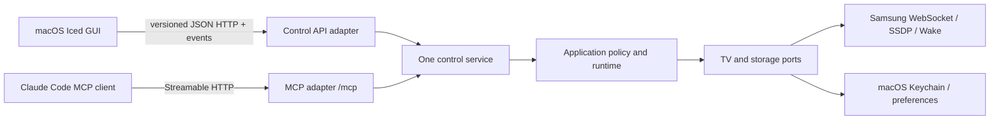

# Phase 2 target architecture

Status: Proposal

This is the target for [Phase 2](phase-2.md), not a description of the
currently shipped single-process app. The [current architecture](../architecture.md)
remains authoritative for code that has not migrated.

M7's application owner and temporary in-process GUI adapter are implemented;
see the [M7 architecture](milestone-07-architecture.md) for actual types and
limits. The process/HTTP/MCP portions below remain the target for later work.

## Process and ownership

The Control API Server is a separate Rust background process. One instance
runs per macOS user and listens on loopback only. It hosts the versioned
control API and `/mcp` in the same process. The GUI and MCP adapter are
separate entry points into one application service; neither owns a TV socket,
pairing token, device repository, command queue, or independent selected TV.
Future Sources, Apps, Text Input, or other TV controls must first become
application service operations; a client cannot add a direct TV adapter.

The server is not launched at login. Opening the GUI attaches to an existing
instance or starts it, and closing the GUI leaves it running. A configured
MCP client also triggers on-demand startup without opening the GUI; a
bundled credential helper is not an MCP CLI/stdio server. A deliberate
**Stop server** is sticky until explicit resume, so neither GUI reconnect nor MCP
reconnect silently reverses it. A crash is not a deliberate stop: the next
client use may start a new server epoch, but never replay a TV action. Startup
uses a single-instance guard and authenticated readiness check; an occupied
port must not be assumed to belong to this app. P2-M6 compares a detached
signed helper with a separate `--server` process of the same signed app
executable for silent legacy-Keychain access, and prototypes a stable per-user
endpoint and survival after GUI exit. An `SMAppService` LaunchAgent is a
fallback only after reviewing its
approval and login-bootstrap behavior. See the [lifecycle and security
research](server-lifecycle-security.md) for the decision and failure matrix.

The [server-internal architecture](control-server-internals.md) refines this
process boundary into a single state owner, bounded effects, operation
registry, and atomic event subscription. It remains a planned design until
the milestone checks prove it in code and a signed bundle.

Keep application code under `src/`:

| Area | Target responsibility |
| --- | --- |
| `src/domain/` | Device identities, semantic actions, and values independent of HTTP, MCP, Iced, and Samsung frames. |
| `src/application/` | Headless control service, one selected-TV state, admission, bounded dispatch, Wake and Pairing workflows, typed outcomes, events, and ports. |
| `src/infrastructure/` | Samsung protocol, SSDP, UDP Wake, preferences, trust store, and macOS Keychain adapters. |
| `src/server/control_http/` | Versioned JSON routes, request validation, authentication, response mapping, and event stream. |
| `src/server/mcp/` | Streamable HTTP transport and MCP tool schemas; translation to the same application requests. |
| `src/control_client/` | Typed HTTP client, credential setup, event subscription, and resynchronization for the GUI. |
| `src/presentation/iced/` | Windows, local navigation and drafts, input mapping, status wording, and rendering of server facts. |
| `src/main.rs`, `src/bin/control_server.rs` | Separate GUI and server composition roots. |

The runtime call path is `GUI → control_client → HTTP adapter → application
→ domain`; the HTTP hop crosses a process boundary. Compile-time dependencies
point inward from adapters to application/domain, with infrastructure
implementing application ports. The composition roots select concrete
adapters. The GUI binary
must not import application coordinator or infrastructure modules; P2-M11 adds
an enforceable source/build check for that boundary. The GUI cutover in P2-M9
must pass that check before release.

## GUI architecture: boundaries, view model, and commands

Use these styles at different scopes rather than as competing frameworks:

| Style | Phase 2 use | Boundary |
| --- | --- | --- |
| Clean Architecture | Keep TV policy in server application/domain; treat HTTP, MCP, Samsung, storage, and GUI as adapters around it. | Neither the Iced view nor the GUI client can own pairing, selection, dispatch, or persistence policy. |
| MVVM-inspired presentation | Iced views render presentation state and emit `Message` values; a GUI view model owns local navigation, drafts, dialog state, display wording, and projections of server facts. | A view model is not another authoritative TV state store and cannot claim a physical result from a request receipt. |
| Typed command handling | Map user intents to explicit control requests; the server service validates and executes them, then publishes receipts, outcomes, and state revisions. | Iced messages, control commands, queries, and server events are different types and responsibilities. |

Keep Iced's unidirectional `Message → update → Task → Message` loop as the GUI
interaction mechanism. Do not import a two-way-binding or per-button
`ICommand` framework merely to call this MVVM. The `App` update function is
the thin presentation coordinator: it handles window lifecycle and maps user
messages to a typed `ControlClient` port. Views read a view model; they do not
call HTTP or the application service. Split view-model state by feature only
when that reduces an actual oversized module or cross-window coupling.

The server snapshot is authoritative for selected TV, selection generation,
pairing, connection, Wake, and operation outcomes. The GUI owns only local
navigation, focus, editable drafts, dialogs, and a projected copy of server
facts tagged with epoch/revision. Pending-operation indicators are local
projections of receipts, not assertions that the TV changed. A stream gap or
epoch change invalidates the projection until resynchronization; local drafts
must not silently overwrite a newer server selection.

Separate a UI event such as `RemotePressed` from the semantic request it
produces. A mutating control request carries the applicable explicit target,
observed epoch/generation or attempt precondition, and client operation key;
the service revalidates all preconditions at admission and immediately before
the TV effect. Read-only queries and event subscription are separate from
mutating commands. HTTP wire DTOs, application command types, and display
models need explicit mappings; do not make a view model, a route handler, or
an MCP tool own a second command dispatcher. Full CQRS, event sourcing, and a
generic command bus are not prerequisites for this design.

The GUI flow is `view → Iced Message → GUI update → ControlClient request →
HTTP adapter → application command handler → receipt/event → view-model
projection → view`. A lost response first uses operation lookup; it never
creates a fresh-key retry on behalf of the user.

## Selection and concurrency

There is exactly one server-wide selected TV. A client changes it with an
explicit selection operation carrying the generation it observed; a stale
selection request is rejected instead of overwriting a newer choice. Remote,
Wake, and connect operations supply a `device_id`, the observed selection
generation, and a client operation key. Discovery and first Pairing use
attempt and observation IDs before a saved device ID exists. Configuration
and forget target an explicit saved TV with their own preconditions. The
service rejects a stale generation or mismatched target for a control command;
it never silently selects another TV. A selection change is an event seen by
all clients and invalidates queued work, Wake attempts, and pending Pairing or
connection completions for the old generation. An in-flight socket write is
reported uncertain when its outcome cannot be known.

The service, not an HTTP or MCP handler, owns one bounded remote-action FIFO
and the active Samsung session. Concurrent GUI and MCP requests enter the same
admission order. Per-client request ordering alone is insufficient: the
service rechecks target, generation, Pairing, and connection immediately
before each write. Pairing attempts use their own attempt IDs and guard; two
clients cannot confirm different certificates under one stale observation.

## Control API contract

The control API uses versioned JSON HTTP endpoints under `/v1` and a
server-sent event stream for state changes. The [M6 contract
draft](milestone-06-contract.md) fixes candidate route names, DTO examples,
admission limits and error mapping; signed and fake-port gates still need to
validate it. The required resource groups are:

| Resource or operation | Required behavior |
| --- | --- |
| State and saved TVs | Atomic snapshot with `server_epoch`, revision, selected TV, generation, connection, Wake progress, and safe saved-device data. |
| Discovery and probe | Start an attempt, return an operation ID, and report candidates or observed certificate identity with expiry. |
| Pairing and re-pairing | Confirm one observed TV/certificate attempt, wait for TV approval, store token only in server Keychain, and return a typed outcome. |
| Select, connect, configuration, forget | Explicit target and preconditions; selection uses compare-and-swap generation, and forgetting uses a confirmation step. |
| Remote action and Power Toggle | Explicit target/generation, bounded admission, an operation ID, and terminal `not_sent`, `written`, or `uncertain` outcome; the server resolves Play/Pause and disconnected Power Toggle. |
| Wake | One packet attempt and trusted reconnect progress, with packet delivery, remote readiness, failure, and uncertainty represented separately. |
| Operation lookup and events | Resolve a lost response without replay; an initial snapshot and ordered revisions let clients recover from a stream gap. |

Every mutation carries the server epoch observed by the client and an
operation key scoped to its authenticated client identity. Within a stated
retention window, the same key and payload return the existing operation;
the same key with a different payload is rejected. A response timeout leads
to lookup by key, never an automatic new-key retry. A changed epoch rejects
old-epoch mutations. After a server crash, an in-memory operation may be
unresolvable; clients display an unknown outcome and require a new, explicit
user action before repeating a side effect. No document claims exactly-once
TV execution across crashes or after retention expires. The M6 contract draft
specifies candidate retention, expiry, and backpressure policy. One client's
acknowledgment cannot erase another client's result.

The control event stream starts with a snapshot and revision captured together
with subscriber registration. Later events have strictly increasing revision
numbers. Alternatively, a cursor-based reconnect must replay every retained
event after the snapshot revision or explicitly require a new snapshot; it
cannot silently miss the interval between snapshot and subscription. A slow
observer is disconnected or told to resynchronize when it falls behind.

Use typed errors for malformed input, unauthenticated or unauthorized client,
stale selection, Pairing required, disconnected TV, busy queue, expired
observation, and unavailable transport or storage. HTTP status and JSON body
mapping are fixed in P2-M6. A successful HTTP response or socket write is not
evidence that the TV changed source, power, playback, or another physical
state. Keep the existing `requested`, `written`, `uncertain`, and `observed`
distinction in every client.

## MCP contract

`/mcp` is a real Streamable HTTP endpoint, never a CLI or stdio wrapper. Its
tools cover the supported Phase 1 operations: list and inspect TVs, discover,
probe, confirm Pairing or re-pairing, select, connect, edit Wake settings,
send semantic remote actions, Wake, inspect operations, and forget. The
`select_tv` tool changes the same server-wide selection seen by the GUI. Tool
inputs for remote, Wake, and connect use explicit device IDs, server epoch,
and selection generation; tool results return typed facts and operation IDs,
not invented TV-state confirmation.

The MCP adapter calls the application service directly within the server
process. It must not invoke its own Samsung connection or synthesize HTTP
calls to the control routes. Pairing requires a prior probe and an explicit
certificate-identity confirmation bound to that observation; forgetting
requires explicit target confirmation. The API checks those steps but cannot
infer that a human approved an MCP client's tool call. Neither tool can expose
a pairing token. Long-running effects return an operation receipt for later
lookup, so a dropped MCP response cannot justify an automatic retry.

Claude Code is the first interoperability target. P2-M6 records the MCP
protocol revision it actually negotiates and the supported revision set.
The [current Streamable HTTP specification](https://modelcontextprotocol.io/specification/2026-07-28/basic/transports/streamable-http)
uses one POST endpoint and changed earlier GET/session behavior; an older
revision must be implemented according to its own specification if needed
for the tested client. P2-M10 verifies the chosen revision with protocol tests
and an actual Claude Code connection.

P2-M10 targets a user-scoped Claude Code HTTP entry with a stable per-user
URL and a bundled dynamic auth-header helper, provisioned by one intentional
GUI action. The helper ensures the server is running, then retrieves only
the MCP client credential; it never transports MCP over stdio or prints TV
pairing tokens. No credential is embedded in client configuration. The
server rejects authorization failures before admitting a TV effect, including
when Claude Code retries a call after refreshing headers.

## MCP context and token budget

Optimize model-visible context and the number of tool round trips, not only
HTTP bytes. P2-M6 records a small sanitized workflow corpus and fixes budgets
for advertised definitions, ordinary receipts, read results, and complete
workflows. P2-M10 measures estimated tokens and actual Claude Code behavior;
P2-M11 treats the chosen budgets as regression gates. Measure with tool search
both enabled and unavailable, because a client may load every tool upfront.
Do not claim savings from compression, JSON whitespace removal, or a client
feature without a model-visible measurement.

Keep a small, stable tool catalog independent of whether a TV is connected or
selected. Use one semantic remote-action tool with an action enum, including
the distinct Power Toggle behavior, rather than one tool per button. Keep
setup, inspection, selection, Wake, operation lookup, and guarded Pairing and
forget as discoverable operations; do not collapse them into an opaque
`execute` tool or arbitrary command batch. Tool names, schema property names,
and descriptions should be short but unambiguous. Put search terms and the
effect at the start of each description; keep a brief server instruction for
when to use these tools and central shared rules. Safety-critical target,
freshness, and confirmation requirements stay in the relevant tool schemas
and descriptions even if they cost tokens. Annotate read-only and destructive
tools accurately, but treat annotations as hints, never authorization.

For the [2026-07-28 tool-list
contract](https://modelcontextprotocol.io/specification/2026-07-28/server/tools),
return tools in deterministic order and choose a private cache TTL consistent
with a catalog that only changes on version or authorization changes. Do not
send `tools/list_changed` merely because connection or selection state changes.
Test catalog invalidation on upgrade and credential changes, and use the
negotiated older revision's rules if Claude Code requires it. Claude Code's
[tool search](https://code.claude.com/docs/en/mcp#scale-with-mcp-tool-search)
can defer definitions, but the baseline catalog must remain usable when tool
search is off; do not force tools to load upfront without measured benefit.
Cached discovery is not a live TV-state or server-readiness signal: Claude
Code may defer connecting until first tool use. That request still passes
on-demand startup, sticky-Stop, authentication, and epoch checks.

Default read tools return a bounded safe summary; separate inspection obtains
details only when needed. Discovery returns bounded candidates with opaque
candidate IDs bound to an attempt and expiry instead of repeating raw network
details. Mutating tools return a terse receipt with operation ID and necessary
target/epoch context, not a full snapshot or a claim that the TV changed.
Operation lookup returns a compact typed terminal outcome; an optional bounded
wait on this read-only lookup may reduce repeated polling. Cancelling lookup must
not cancel or replay the underlying effect. Errors include a stable code and
one actionable next step, with just enough fresh selection context to avoid
an otherwise mandatory extra status call. Never truncate a certificate
fingerprint, confirmation requirement, `uncertain` outcome, or other safety
fact to meet a budget.

Evaluate [structured tool
results](https://modelcontextprotocol.io/specification/2026-07-28/server/tools#structured-content)
with an output schema against a terse text result in the tested client. The
current spec recommends a serialized text copy for compatibility, which may
duplicate model-visible content; structured output alone is not a proven
token saving. Choose the smallest revision-compatible representation that the
target client actually handles, and document any omitted recommended text
fallback. Do not stream routine server state changes into MCP model context:
the GUI uses `/v1` events, while MCP calls query status or a specific operation
when needed. No optimization may omit explicit device IDs, epoch/generation,
client operation keys, Pairing/forget confirmation, or honest outcome states.

## Local access and data

Bind only to `127.0.0.1`; do not expose control to the LAN or internet in this
phase. Validate the HTTP Host and MCP Origin, reject untrusted origins, and
avoid wildcard CORS. Authenticate read and write requests, including the
event stream. Use server-issued credentials with distinct GUI and MCP client
identities. The GUI obtains its credential through a protected local
bootstrap; Claude Code gets a separate credential through its signed auth
helper, not a copied token. P2-M6 fixes peer authentication, same-user threat
model, credential storage, rotation, revocation, and whether the chosen
local mechanism implements or intentionally omits the optional MCP OAuth
authorization flow. Never publish a credential through an unauthenticated
localhost route or put it in a URL.

Authorization and certificate-trust decisions are different: a local client
credential cannot bypass TV certificate confirmation or TV-approved Pairing.

The server alone opens the TV WebSocket, sends UDP Wake, reads or writes saved
TVs, and accesses TV pairing tokens in Keychain. Authorized clients can see
the safe information required for setup, but logs, diagnostics, test
fixtures, and MCP tool descriptions must omit tokens, private text, raw
certificates, and real TV addresses. Bound request size, result retention,
event backlog, and concurrent long-running operations.

The signed server's access to **existing GUI-created Keychain items is an
unproven migration gate**. P2-M6 tests a synthetic legacy item under the old
and new executable identities. P2-M9 cannot cut over real profiles until the
read/update/delete path or a safe user-assisted migration is demonstrated.
Keychain denial or a locked Keychain is a visible blocked state, not an empty
device list. macOS Local Network consent and TV-side Pairing approval cannot
be bypassed; routine restarts must not re-prompt when permissions and signing
identity remain stable. One explicit user-assisted migration/Keychain approval
is allowed; it is distinct from routine prompts. Phase 2 targets the owner’s
Mac and local signed installation. Notarization and public distribution are
outside this phase’s acceptance scope.

## Migration sequence

1. Freeze the contract and characterize current behavior (P2-M6).
2. Extract a headless application runtime while the GUI uses a temporary
   local adapter (P2-M7).
3. Introduce the server with the authenticated control API and events
   against isolated fake ports and storage (P2-M8). An alternate preferences
   path alone does not isolate the current Keychain service.
4. Switch every GUI setup and control flow to the API and remove its local
   runtime adapter in one release cutover (P2-M9). This milestone builds the
   M6-selected signed GUI/server process packaging and proves legacy Keychain
   access/migration. Never run the old GUI and new server against the same
   live profile during migration.
5. Add the MCP HTTP adapter and a token-free, user-scoped Claude Code
   connection path over the same service (P2-M10).
6. Harden packaging and lifecycle, verify two clients plus crash and data
   recovery, test unavoidable macOS/TV approvals, then remove any remaining
   direct-control path and update the current architecture (P2-M11).

Preserve existing `devices.json`, `trust.json`, Keychain service/account
names, selected-TV preference, and Wake configuration unless a tested,
backed-up migration is explicitly specified. Phase 1's unresolved native
accessibility and live-Wake checks remain visible in the acceptance record;
this refactor does not make unsupported hardware claims.
